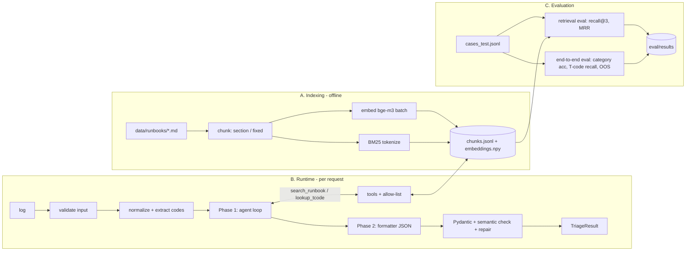
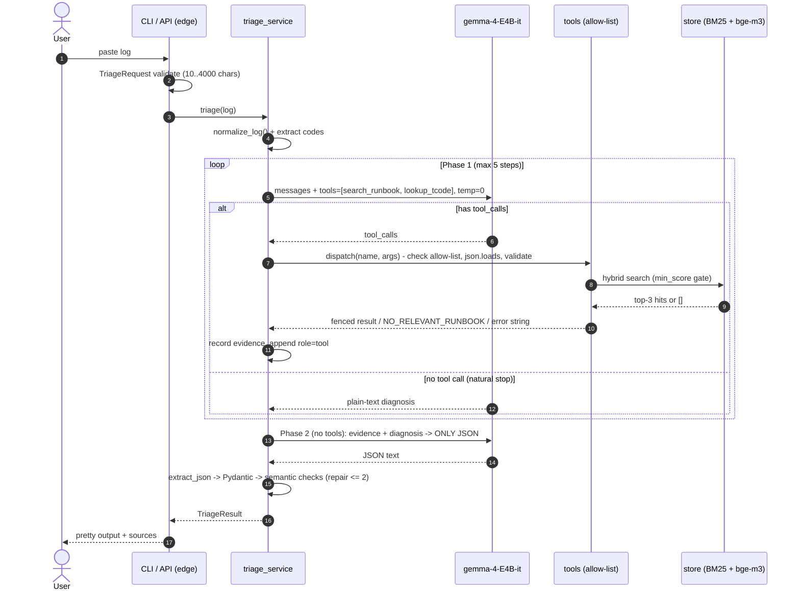
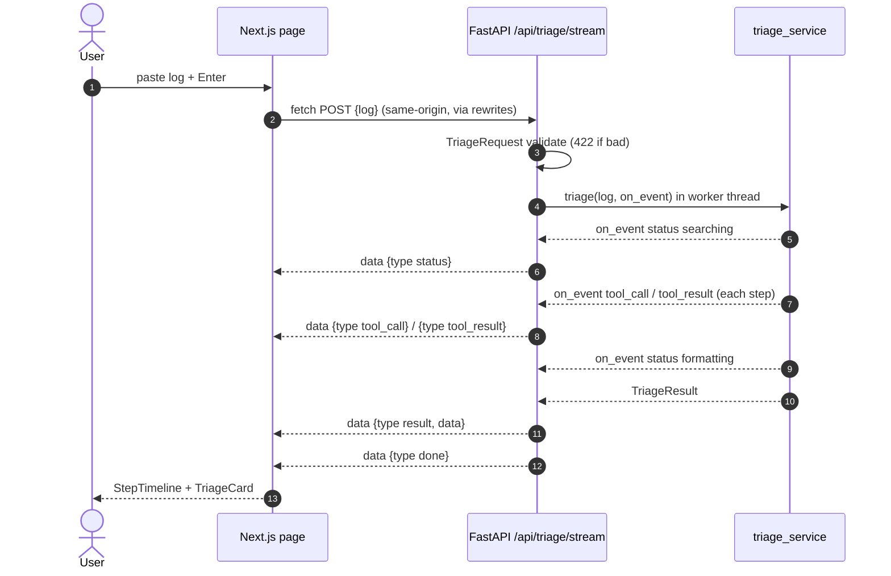

# 04 — System Flow (ตั้งแต่เริ่มต้นจนจบ)

ระบบมี 3 flow:
- **A. Indexing** (offline, รันเมื่อแก้ runbook): `uv run python -m app.retrieval.ingest`
- **B. Runtime** (ทุกครั้งที่มี log เข้ามา): `uv run python -m app.cli < sample.log`
- **C. Evaluation** (เก็บตัวเลขลงรายงาน): `uv run python -m eval.run_all`

> แผนภาพเขียนด้วย Mermaid — เปิดดูใน VS Code (extension "Markdown Preview Mermaid Support") หรือบน GitHub ได้เลย

## ภาพรวม


---

## A. Indexing

| ขั้น | ทำอะไร | รายละเอียด / กฎ |
|---|---|---|
| A1 Load | อ่าน `data/runbooks/*.md` | อ่าน front-matter: `doc_id`, `category`, `title`, `tcodes`, `references` |
| A2 Chunk | 2 กลยุทธ์ (เลือกด้วย `CHUNK_STRATEGY`) | `fixed`: 800 ตัวอักษร overlap 150 (naive default = ของ reference) · `section`: 1 chunk ต่อ `## หัวข้อ` + prefix `"[{title}] [{category}] {section}: "` เพื่อให้ chunk รู้บริบท |
| A3 Embed | `embeddings.create(model="bge-m3", input=[...])` ทีละ batch | เก็บ `data[i]` ↔ `chunks[i]` ตามลำดับ (L5 หน้า 39) |
| A4 BM25 | tokenize ด้วย regex `[A-Za-z0-9_/]+` → lower | `TSV_TNEW_PAGE_ALLOC_FAILED` อยู่ครบเป็น 1 token; `RC=8` → `rc`,`8` (หรือ normalize เป็น `rc8`) |
| A5 Store | เขียน `chunks.jsonl` (id, doc_id, category, section, text) + `embeddings.npy` | ลบของเก่าก่อน (กัน stale index — L6 หน้า 22) |

ตัวอย่าง chunk:
```json
{"chunk_id": "mem_tsv_tnew_page_alloc#cause", "doc_id": "mem_tsv_tnew_page_alloc",
 "category": "memory_dump", "section": "Cause",
 "text": "[TSV_TNEW_PAGE_ALLOC_FAILED] [memory_dump] Cause: An internal table needed more memory than ..."}
```

---

## B. Runtime — 1 request ตั้งแต่ต้นจนจบ



### B1. รับ input (edge)
- CLI: อ่าน stdin หรือไฟล์ · API: `POST /api/triage {"log": "..."}`
- `TriageRequest` (Pydantic) ปฏิเสธ log ว่าง/ยาวเกิน → CLI แจ้ง error, API ตอบ 422 (L3 หน้า 14–16)

### B2. Normalize (ไม่ใช้ LLM)
- ตัด: timestamp, memory address (`0x...`), บรรทัดว่างซ้ำ, ตัดเหลือ ≤ 2,000 ตัวอักษรส่วนสำคัญ
- ดึงด้วย regex: `Runtime Errors\s+(\w+)`, `RC\s*=?\s*(\d+)`, T-code `\b(S[MTUP]\d{2}|STMS|...)\b`, job name, ข้อความ error ภาษาอังกฤษบรรทัดแรก
- ได้ `normalized_log` + `key_tokens` (ส่งให้โมเดลเป็นคำใบ้ query — L6 หน้า 27 "fix the query")

### B3. Phase 1 — agent loop (หัวใจ)
```python
messages = [system, user(<log>…</log> + key_tokens)]
seen_queries, evidence = set(), []
for step in range(MAX_STEPS):
    msg = llm.chat(messages, tools=TOOL_SPECS, temperature=0)
    if not msg.tool_calls:                 # natural stop  (L10 หน้า 16-17)
        diagnosis = msg.content; break
    messages.append(msg)                   # assistant + tool_calls
    for call in msg.tool_calls:            # ตอบทุก id  (L10 หน้า 25)
        result = dispatch(call.function.name, call.function.arguments,
                          seen_queries, evidence)
        messages.append({"role": "tool", "tool_call_id": call.id, "content": result})
else:                                      # ถึง MAX_STEPS
    messages.append(user("Stop searching. Answer from the tool results above."))
    diagnosis = llm.chat(messages, temperature=0).content
```
`dispatch()` ทำ: ชื่ออยู่ใน `TOOLS`? → `json.loads` (try) → validate args (Pydantic/regex) → query ซ้ำ? → รัน → คืน **string เสมอ** (error ก็เป็น string ให้โมเดลอ่านแล้วแก้เอง — L10 หน้า 27–28)

ตัวอย่าง trace จริงที่คาดหวัง:
```
step1  → search_runbook("TSV_TNEW_PAGE_ALLOC_FAILED internal table memory")
       ← [1](mem_tsv_tnew_page_alloc#symptoms) [2](mem_tsv_tnew_page_alloc#check) [3](mem_system_no_roll#cause)
step2  → lookup_tcode("ST02")      ← "ST02: Tune Summary — buffer and memory usage"
step3  ← (no tool call) "This is a memory dump: the internal table ... check ST22 then ST02 ..."
```

### B4. Phase 2 — formatter (structured output)
- เรียกโมเดล **ไม่ส่ง tools** · prompt = schema + ตัวอย่าง 1 ชิ้น + EVIDENCE (numbered, เฉพาะที่ tool คืนจริง) + diagnosis
- `extract_json()` → `TriageResult.model_validate()` → semantic checks
- ไม่ผ่าน → append คำตอบผิด + error → ถามใหม่ (≤ 2) → ยังไม่ผ่าน → **fallback** จาก runbook top-1 (confidence=low)

### B5. Post-check (โค้ดตัดสิน ไม่ใช่โมเดล)
- `sources` ∩ evidence ids (ตัดตัวที่แต่ง)
- `tcodes` ∩ `tcodes.json` (ตัวนอก list → `unverified_tcodes`)
- evidence ว่าง (ทุก search = NO_RELEVANT_RUNBOOK) ⇒ บังคับ `category="out_of_scope"`

### B6. Output
CLI แสดง:
```
Category : memory_dump   (confidence: high)
Summary  : Internal table in ZFI_MONTHLY_REPORT exhausted heap/extended memory.
Open     : ST22 → ST02 → SM37
Steps    : 1. ST22: open the dump, read "Error analysis" & "Information on where terminated" ...
Sources  : mem_tsv_tnew_page_alloc#check, mem_tsv_tnew_page_alloc#fix
```
(+ `--json` แสดง JSON ดิบ, `--trace` แสดงทุก step ของ agent ใช้ตอน demo)

### เส้นทาง error
| จุด | เกิดอะไร | ระบบทำอะไร |
|---|---|---|
| input ผิด | ว่าง / > 4000 | 422 / ข้อความ CLI |
| proxy ล่ม | timeout / 5xx | 504 / 502 + log ฝั่งเรา (ไม่โชว์ key/stack) |
| tool args ผิด | JSON เสีย / regex ไม่ผ่าน | คืน error string → โมเดลแก้เอง |
| loop ไม่จบ | ถึง 5 step / query ซ้ำ | บังคับตอบจากที่มี |
| JSON พัง | parse/validate fail | repair ≤ 2 → fallback |
| ไม่มี runbook ตรง | min_score gate | `out_of_scope` ไม่เดา |

---

## C. Evaluation flow
```
cases_dev.jsonl (10)  → จูน MIN_SCORE / เลือก chunk strategy   (ห้ามใช้ test จูน)
cases_test.jsonl (30) → รายงานผล
   ├─ run_retrieval.py : ส่ง query จาก log (ผ่าน normalize) เข้า search() ตรงๆ, mode = bm25|dense|hybrid
   │                     → recall@3, MRR (ระดับ doc_id) ; ข้อ OOS วัดแยก: ถูก gate ทิ้งไหม
   ├─ run_e2e.py       : รัน triage() เต็ม → category accuracy, T-code recall, OOS refusal accuracy,
   │                     valid-JSON rate, avg steps ; baseline = LLM ตอบเลยไม่มี RAG/tools
   └─ results/*.json + results.md (ตาราง) + failures.jsonl (ข้อที่ผิด ไว้วิเคราะห์ในรายงาน)
```
รายละเอียด metric/การทดลองอยู่ใน `09_eval_plan.md`

---

## D. Web flow (เพิ่ม 7 พ.ย.)

- browser อ่าน stream ด้วย `fetch` + reader + buffer ตัดที่ `\n\n` (ไม่ใช้ EventSource เพราะต้อง POST)
- ปุ่ม Stop = `AbortController`; proxy ล่ม = frame `error` แล้ว `done`
- รายละเอียด: `12_web_ui_nextjs.md`
